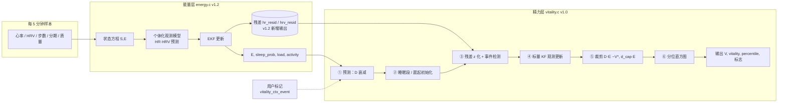
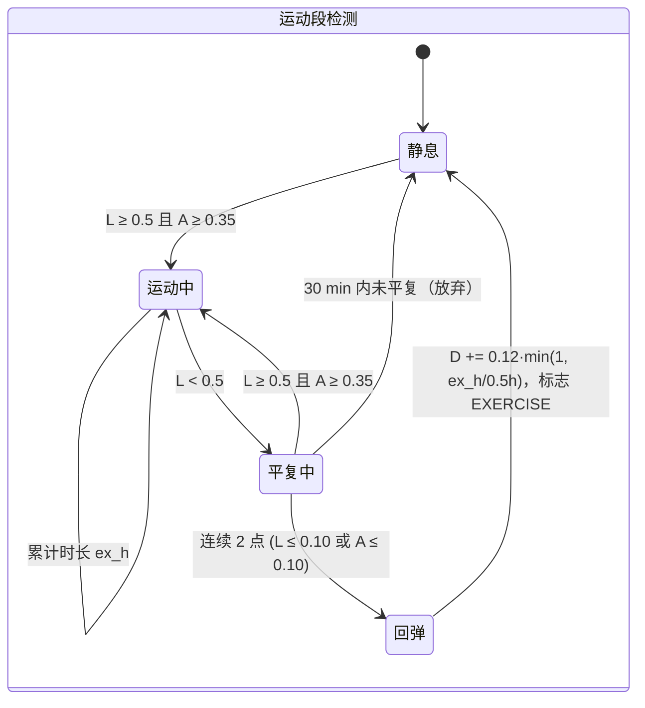
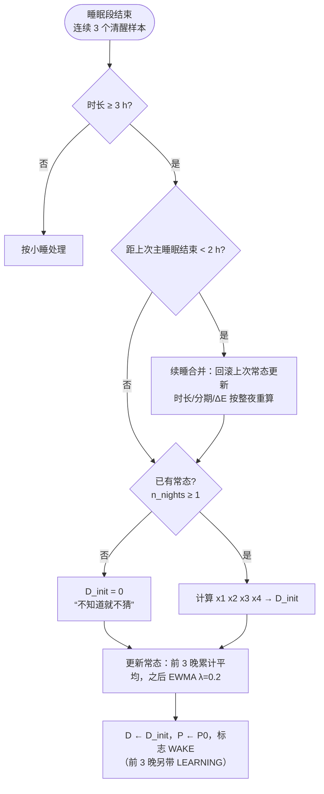

# 精力（Vitality）层算法设计 v1.1

> 建立在能量层（`energy.h`，v1.2）之上的第二个状态量。能量回答"储备还剩多少"，精力回答"此刻用得出来多少"。本文是实现 `include/vitality.h` / `src/vitality.c` 的设计依据；所有数字均来自仓库内的实测输出（`make test`、`make example`、`make bench`），均为**合成数据**结果，未在真实用户数据上验证。

---

## 0. 一句话模型

```
V(t) = clip( V*(t) + D(t), 0, 1 )

V*(t) = E(t) · [ 1 + ρ · c(t) ]              均衡线：能量 × 昼夜节律
dD/dt = − D / τ_D(E) + Σ 事件脉冲 + 观测修正    偏离量：一阶均值回复 + 卡尔曼修正
```

- `E`：能量层输出的能量状态（0–1，只相对本人基线）。
- `c(t)`：能量层已有的昼夜节律形状（10 点峰、14:30 低谷），`ρ = 0.15`。
- `D`：精力相对均衡线的**暂时**偏离，可正可负，自动衰回 0；这是精力层唯一新增的隐状态。
- 两个 0–100 刻度：`vitality = 100·V`（绝对自我刻度）与 `percentile`（本人过去约 28 天日间 V 的分位）。**没有任何跨人比较**。

---

## 1. 为什么要有第二个状态量

| 现象 | 能量 E | 精力 V | 只有 E 时的问题 |
|---|---|---|---|
| 下午 3 点喝完咖啡，心率略升、精神来了 | 继续下降（储备没变） | 短暂上浮 | 用户觉得"明明有精神，为什么分数还在掉" |
| 20 分钟午睡 | 略升 | 明显回弹后 1 小时内衰回 | 午睡的"立刻清醒"体现不出来 |
| 连续开会 1 小时、心率 +22 bpm | 消耗加快 | 下压（过载） | E 慢变量，反应滞后 |
| 睡得比平时好 / 差 | 晨起 E 高 / 低 | 醒来高于 / 低于均衡线 | 同样的 E，主观状态可能不同 |

所以精力层的任务只有一个：**在不改动能量层的前提下，把"短时的、会自己消退的"状态变化单独建模**，并且保证没有观测时它退化为均衡线（不会无中生有）。

---

## 2. 总体结构（级联，不是联合滤波）



设计决策：

1. **级联而不是把 D 加进能量层的状态向量。** 能量层已经有 S/E 两维和自己的观测模型；把 D 并入会让能量层的基线学习与 D 互相解释（"心率高是因为基线偏了还是因为 D 高？"），不可辨识。级联后能量层完全不变，精力层只消费其**残差**：能量层解释不了的心率/HRV 偏差，就是精力层的观测。
2. **观测 = 残差，而不是原始心率。** 残差已经扣掉了个人基线、昼夜节律、活动负荷与 E 本身的贡献，因此体质差异（静息心率 55 还是 75）不会进入精力。测试 `test_constitution_invariance`：整体心率 +8 bpm，第 4 天起精力分差 < 3 分。
3. **事件只认生理效应，不猜原因。** 库内只识别"运动结束的回弹""小睡的回弹""持续低 HRV 的拖拽""交感激活（唤醒 / 过载）"，这些都能从负荷、活动量、残差里看见；咖啡、冥想、压力事件等**原因**只能由用户标记注入（`vitality_ctx_event`），没有标记时通过心率间接体现。

---

## 3. 隐状态 D 的动力学

### 3.1 连续时间方程与离散解

```
dD/dt = − D / τ_D(E)
τ_D(E) = τ0 · [ 1 + λ · (1 − E) ]          τ0 = 0.75 h，λ = 1.5
```

能量充沛时 τ_D = 45 min（一杯咖啡的"劲"一小时内消退）；能量见底时 τ_D = 112 min（疲惫状态下任何波动都恢复得慢）。步长 h 的解析解：

```
k = exp(−h / τ_D)
D ← k·D
P ← k²·P + q_d·h               q_d = 0.02 /h，P0 = 0.01（晨起先验标准差 0.1）
```

过程噪声 q_d 与 τ_D 匹配：稳态 P ≈ q_d·τ_D/2 ≈ 0.0075，对应 D 的先验标准差约 0.09。

### 3.2 有界性

```
−V*  ≤  D  ≤  d_cap · E          d_cap = 0.30
```

下界保证 V ≥ 0；上界表示"透支也有限度"：E = 0.4 时精力最多比均衡线高 0.12。每步观测更新后裁剪一次（`vitality_d_bounds`）。

### 3.3 均衡线

```
V*(t) = E · [ 1 + ρ · c(tod) ]      ρ = 0.15
```

`c(tod)` 直接复用能量层的 `energy_circadian()`（峰 10:00、谷 14:30、谷深 0.7、谷宽 1.6 h），所以两条曲线的节律形状天然一致，用户看到的"下午犯困"在两条线上同步出现。测试 `test_batch_basic` 验证无事件日 10:00 的 V* > 14:30 的 V*。

---

## 4. 一次 `vitality_ctx_step` 的流程

```mermaid
flowchart TD
    S0([样本进入]) --> S1[energy_ctx_step<br/>得到 E, sleep_prob, load, activity, 残差]
    S1 --> P1[① 预测<br/>D ← e^(−h/τ_D)·D，P ← k²P + q_d·h]
    P1 --> P2{有待注入的<br/>用户脉冲?}
    P2 -- 是 --> P2a[按一阶起效注入<br/>咖啡 τ=20 min，其余即时] --> P3
    P2 -- 否 --> P3
    P3{sleep_prob ≥ 0.5?}
    P3 -- 是 --> SL[累计睡眠段：时长、分期、醒前 1 h HRV<br/>标志 SLEEP，本步无观测]
    P3 -- 否 --> AW{刚从睡眠段出来?<br/>连续 3 个清醒样本}
    AW -- 是，时长 ≥ 3 h --> MI[晨起初始化<br/>D ← D_init，P ← P0，更新常态<br/>标志 WAKE]
    AW -- 是，15 min–3 h 且在 9–20 点 --> NAP[小睡脉冲 +a_nap<br/>标志 NAP]
    AW -- 否 --> OBS
    MI --> OBS
    NAP --> OBS
    SL --> CLAMP
    OBS[③ z 化残差<br/>z_hr = hr_resid/7，z_hrv = hrv_resid/0.40] --> W[观测权重 w_act<br/>按活动量 A、负荷 L 降权]
    W --> EV[事件检测<br/>运动段 / 无分期小睡 / 低 HRV 拖拽 / 唤醒·过载标志]
    EV --> KF1{w_act > 0 且 z_hr 有效?}
    KF1 -- 是 --> U1[u = 倒 U 变换 z_hr<br/>标量 KF：y=u, H=a_hr, R=r_hr/w_act]
    KF1 -- 否 --> KF2
    U1 --> KF2{w_act > 0 且 z_hrv 有效?}
    KF2 -- 是 --> U2[标量 KF：y=z_hrv, H=a_hrv, R=r_hrv/w_act]
    KF2 -- 否 --> CLAMP
    U2 --> CLAMP[⑤ 裁剪 D ∈ −V*, d_cap·E]
    CLAMP --> PCT[⑥ 日间 V 记入分位直方图<br/>按日历日衰减，半衰期 14 天]
    PCT --> OUT([输出 vitality_point_t])
```

每步固定开销，没有随历史长度增长的循环（分位查询遍历 50 个桶）。`make bench`（桌面 x86-64，-O2，21 天面板）：能量流式 4.56 µs/步，能量+精力 8.62 µs/步，精力层增量约 4.06 µs/步；`vitality_ctx_t` 3976 B（含 `energy_ctx_t` 2344 B；v1.1 新增 31 箱血氧直方图）。

---

## 5. 观测模型

### 5.1 残差来源（能量层 v1.2 新增输出）

能量层每步在观测更新前记录 `resid = y − (level + reg)`：`level` 是本人该通道的基线，`reg` 是昼夜节律 + 活动负荷 + E 的回归项。精力层拿到的 `hr_resid`（bpm）与 `hrv_resid`（ln 单位）即"能量层解释不了的部分"。夜间与缺口样本的残差不用（`NO_OBS`）。

### 5.2 z 化与倒 U 变换

```
z_hr  = clip(hr_resid / σ_hr, −6, 6)        σ_hr = 7 bpm（与能量层 sigma_hr_day 一致）
z_hrv = clip(hrv_resid / σ_hrv, −3, 3)      σ_hrv = 0.40

u(z_hr) = z·(1 − z/z_c)        z ≥ 0，z_c = 2.8：轻度唤醒抬精力，超过 z_c（≈ +20 bpm）转为过载
        = 0.6·z                z < 0：心率低于常态 = 犯困
u ∈ [−2, z_c/4]
```

倒 U 的物理含义：静坐时心率比本人常态高 5–10 bpm 通常是"兴奋 / 专注 / 咖啡"，高 20 bpm 以上且没在动则是"紧张 / 过载"。测试 `test_events`：+10 bpm 持续 45 min 使 D 上升 > 0.01（示例输出 09:15 → 10:15 由 +0.028 升到 +0.061）；+22 bpm 持续 1 h 使 D 下降 > 0.01。

### 5.3 标量卡尔曼更新

```
y = H·D + ε，   H = a_hr (3.0) 或 a_hrv (2.0)，   R = r / w_act
S = H²P + R，   K = P·H / S，   新息 ν = y − H·D
门控：|ν| / √S > 4 → 丢弃
D ← D + K·ν，   P ← (1 − K·H)·P
```

两条通道顺序更新（先心率后 HRV），每条都是标量运算，没有矩阵。

### 5.4 观测权重 w_act（为什么用活动量而不是负荷）

```
w_act = clip( 1 − (A − 0.10) / (0.35 − 0.10), 0, 1 )
若 L > 0.60：A ≥ 0.10 → w_act = 0（在运动）；A < 0.10 → w_act × 0.5
```

负荷 L 本身含心率项：心率一高 L 就高，如果用 L 排除观测，恰好把我们想测的"心率高但没动"（交感激活）排除掉了。活动量 A 来自步数，是外生的，所以 A 是主判据；L 高而 A 低只降权一半，保留信息但降低信任。

---

## 6. 事件检测



| 事件 | 判据 | 效应 | 示例实测（第 4 天） |
|---|---|---|---|
| 运动回弹 | 上图；要求 A 也高，排除"心率高但没动" | 结束时 +0.12（30 min 满额，10 min 起算） | 18:00–18:30 跑步，18:35 D 由 −0.011 → **+0.096**，精力 39.8 → 50.6 |
| 小睡（有分期） | 睡眠段 15 min–3 h，且在 9–20 点 | +0.15（20 min 满额） | 13:00–13:20 午睡，13:30 D 由 −0.008 → **+0.129**，精力 55.6 → 68.6 |
| 小睡（无分期） | z_hr ≤ −0.75 且 A < 0.05 持续 ≥ 15 min 后恢复 | 同上 | — |
| 疲劳拖拽 | z_hrv ≤ −1 且 w_act > 0 持续 ≥ 30 min | 持续项：dD = −0.03·(−z_hrv)·dt | — |
| 唤醒标志 | 0.7 ≤ z_hr ≤ 2.1 | 只打标志 AROUSAL，效应走观测通道 | 09:30–10:15 |
| 过载标志 | z_hr > 2.1 持续 ≥ 10 min | 只打标志 STRESS，效应走观测通道 | — |
| 用户标记 | `vitality_ctx_event` | 咖啡 +0.10（20 min 一阶起效）、冥想 +0.08、压力事件 −0.10、酒精 −0.08 | 15:00 咖啡标记，D 由 +0.006 → 15:15 **+0.042**，约 1.5 h 衰回 |

关于咖啡的诚实说明：示例里咖啡标记只抬了约 0.04 而不是 0.10，因为合成数据里心率没有相应升高，观测把它拉回来了。真实用户喝了咖啡心率通常会升 3–8 bpm，此时观测与标记同向。库不试图从数据里"识别"咖啡。

---

## 7. 晨起初始化（D_init）

每次主睡眠（≥ 3 h）结束：

```
x1 = clip( (ΔE − ΔE̅) / 0.30, −0.5, 0.5 )                 今晚能量回充量 vs 本人常态
x2 = clip( (HRV_wake − HRV̅_wake) / (2·0.22), −0.5, 0.5 )  醒前 1 h 的 HRV vs 本人夜间常态
x3 = clip( 0.5·q_时长 + 0.25·q_深睡 − 0.25·q_碎片, −0.5, 0.5 )
     q_时长 = clip((睡眠时长 − 常态)/2 h, −1, 1)，深睡占比差 10 个百分点记满分，碎片化同理
x4 = clip( 0.5·q_血氧均值 − 0.5·q_瞬时下跌, −0.5, 0.5 )      v1.1：夜间血氧平稳度，见 §7.1；无血氧时 0

D_init = 0.40 · clip( 0.4·x1 + 0.3·x2 + 0.3·x3 + 0.2·x4, −0.5, 0.5 )     |D_init| ≤ 0.2
```



要点：

- **四项都是相对本人常态的偏差**，常态由库内在线学习（`vitality_habit_t`，可通过 `set/get_habit` 持久化，换机不丢）。没有常态的项记 0。
- **续睡合并**：夜里醒 20 min 再睡，不会把一夜拆成两晚。测试 `test_night_resume_merge`：有夜醒与无夜醒两次运行，学到的晚数相同、常态时长差 < 0.3 h、碎片化更高。
- 示例实测：正常晚 D_init 为 +0.113 / +0.065 / +0.033（冷启动头几天 E 逐日抬升，回充量相对常态偏高，属于能量层冷启动的伴随现象）；只睡 5 h 那晚 D_init = **−0.072**（起床点经首个观测更新后显示 −0.053）。幅度没有到 −0.2 的原因是 x1 项部分抵消：熬到 0 点才睡的人入睡时 E 更低，5 h 回充量并不比平时少多少，而时长项 x3 给了 −0.4 左右。测试 `test_morning_init` 断言短睡那天的 D_init 比前一天低 > 0.02 且 < 0。

### 7.1 夜间血氧平稳度（v1.1）

**要不要用血氧，先看生理，再看信噪比。** 戒指在指端做反射式 PPG，灌注好、夜间手不动，血氧可用性明显高于腕戴设备；但"测得准"不等于"该进模型"：

| | 日间静息 SpO₂ | 夜间 SpO₂ |
|---|---|---|
| 与精力的生理关系 | 几乎没有。疲劳、压力、咖啡改变的是自主神经平衡与心率，不改变动脉血氧；健康人静息 SpO₂ 稳定在 96–99%，氧合曲线在此为平台段，PaO₂ 变化几个 mmHg 看不出来 | 有。夜间通气不稳 → 短暂缺氧 → 化学感受器驱动的交感激活、心率突升、微觉醒；微觉醒常短于分期算法分辨率，分期仍标"睡着"，但恢复质量已打折。饮酒、鼻塞、仰睡、高海拔、感冒都先体现在这里 |
| 信噪比 | 差：变化（< 1%）小于传感器噪声（约 ±2%），手部活动伪迹大 | 好：手不动、灌注稳定；只看相对本夜中位数的下跌，不依赖绝对精度 |
| 与 HR / HRV 的冗余 | — | HR / HRV 看到的是交感激活这个**结果**，血氧看到的是通气不稳这个**原因**；心率突升可被分期 / 翻身解释掉，血氧下跌不会 |
| 结论 | **不用**（也不做日间观测通道：噪声会被卡尔曼当成状态变化，稀释真正的观测） | **用**，作为晨起初始化第四项，权重 0.2 |

实现（常数内存，流式 == 批量）：

```
每个睡眠样本：low = min(spo2, spo2_min)（spo2_min 缺失时取 spo2）→ 1% 分箱直方图 [70, 100]；mean 累加
整夜：median = 直方图中位数     dip = 占比( low ≤ median − 3 )     mean = 均值
覆盖：有效样本 ≥ 50% 睡眠样本 且 ≥ 12 个（1 h），否则本夜不用血氧（x4 = 0，无 SPO2 标志，常态不更新）

q_均值 = clip( (mean − mean̅) / 1.5, −1, 1 )   高于常态的正向收益减半（SpO₂ 有天花板）
q_下跌 = clip( (dip − dip̅) / 0.10, −1, 1 )
x4 = clip( 0.5·q_均值 − 0.5·q_下跌, −0.5, 0.5 )   x4 ≤ −0.25 → 晨起点打 BREATH 标志
常态 mean̅ / dip̅：前 3 个有血氧的夜累计平均，之后 EWMA λ = 0.2；随 vitality_habit_t 持久化
```

- 样本不传血氧（NAN / 0 / 超出 [50,100]）或 `w_spo2 = 0` 时，所有输出与 v1.0 **逐位一致**（`test_spo2`）；旧画像（memset 0）可直接 `set_habit`。
- 只说"昨夜血氧比你平时不稳"，不设绝对阈值（如 90%），不区分原因，不做任何健康状况判断；高原常住者的常态就是 92%，不会被当成"差"。
- 幅度上限 0.40 × 0.2 × 0.5 = 0.04：血氧刻意放在"修正项"的位置，不会单独决定一天的起点。
- 示例实测（`make example` 第 6 天）：睡够 8 h，但前一夜血氧均值 94.0%（平时 97%）、瞬时下跌占比 18%（平时 0）→ x4 = −0.5，D_init = **−0.040**（同一夜不带血氧为 0.000），起床精力 82.3，均衡线 85.1。
- 续睡合并时血氧直方图随分期统计一起保留，按整夜重算。

---

## 8. 0–100 刻度与四象限

### 8.1 两种刻度（都只跟自己比）

| 刻度 | 定义 | 何时可用 | 用途 |
|---|---|---|---|
| `vitality` | 100·V | 立即 | 曲线、带宽、与能量同图 |
| `percentile` | 本人日间 V 的经验分位，50 桶直方图，按日历日指数衰减（半衰期 14 天 ≈ 28 天有效窗口） | ≥ 3 个日间（`PCT_READY`） | "比你 80% 的时候好"这类文案 |

`score_mode` 选择 `score` 列取哪个：0 = vitality，1 = percentile（不可用时退回 vitality），2 = 两者平均。批量模式对 `vitality/score/带` 做 15 min 中心平滑，**不改 `v`/`d`**（那是状态，流式与批量逐点一致到 1e-9，见 `test_stream_equals_batch`）。

### 8.2 95% 带

```
d_sd = sqrt( P + (V*/E)² · e_sd² )        把能量层的不确定性也折进来
lower/upper = 100 · clip( V ∓ 1.96·d_sd )
```

### 8.3 四象限（产品文案）

| | 精力 ≥ 0.5 | 精力 < 0.5 |
|---|---|---|
| **能量 ≥ 0.5** | 状态极佳 | 暂时低迷，稍事休息即可 |
| **能量 < 0.5** | 状态不错但储备不足，别透支 | 建议休息 |

阈值 `quadrant_e / quadrant_v` 可配置。

---

## 9. 参数总表（默认值）

| 组 | 参数 | 默认 | 含义 |
|---|---|---|---|
| dyn | tau0_h / lambda | 0.75 h / 1.5 | τ_D = τ0·(1+λ(1−E)) |
| dyn | d_cap | 0.30 | D ≤ d_cap·E |
| dyn | q_d / p0 | 0.02 /h / 0.01 | 过程噪声、晨起初始方差 |
| obs | sigma_hr / sigma_hrv | 7 bpm / 0.40 | 残差 z 化尺度 |
| obs | a_hr / a_hrv | 3.0 / 2.0 | 观测斜率 |
| obs | r_hr / r_hrv | 1.0 / 2.0 | 观测噪声方差 |
| obs | z_c / drowsy_gain / y_min | 2.8 / 0.6 / −2 | 倒 U 变换 |
| obs | rest_activity / act_zero / load_zero | 0.10 / 0.35 / 0.60 | 观测权重 |
| obs | gate_sigma | 4.0 | 新息门控 |
| event | a_exercise / exercise_min_h / exercise_full_h | 0.12 / 10 min / 30 min | 运动回弹 |
| event | load_on / load_off | 0.5 / 0.10 | 运动段进入 / 平复 |
| event | a_nap / nap_min_h / nap_full_h / nap_max_h | 0.15 / 15 min / 20 min / 3 h | 小睡 |
| event | nap_z_hr / nap_tod | −0.75 / [9, 20) | 无分期小睡 |
| event | a_fatigue / fatigue_z / fatigue_min_h | 0.03 / −1.0 / 0.5 h | 低 HRV 拖拽 |
| event | arousal_z_lo / arousal_z_hi / stress_min_h | 0.7 / 2.1 / 10 min | 标志位 |
| event | a_caffeine / caffeine_tau_h | +0.10 / 20 min | 用户标记默认幅度 |
| event | a_meditation / a_stressor / a_alcohol | +0.08 / −0.10 / −0.08 | 同上 |
| morning | gain / w_delta_e / w_hrv / w_sleep / w_spo2 | 0.40 / 0.4 / 0.3 / 0.3 / 0.2 | D_init |
| morning | spo2_dip_delta / spo2_mean_scale / spo2_dip_scale / spo2_min_cover | 3 / 1.5 / 0.10 / 0.5 | 夜间血氧（§7.1） |
| morning | sigma_hrv_night / lambda / cold_nights | 0.22 / 0.20 / 3 | 常态学习 |
| morning | min_sleep_h / min_sleep_prob | 3 h / 0.5 | 主睡眠判定 |
| display | rho / peak / dip / dip_depth / dip_width | 0.15 / 10 / 14.5 / 0.7 / 1.6 h | 均衡线节律 |
| display | smooth_minutes / band_z | 15 / 1.96 | 展示 |
| display | score_mode / pct_half_life_days / pct_min_days | 0 / 14 / 3 | 刻度 |
| display | quadrant_e / quadrant_v | 0.5 / 0.5 | 四象限 |

`vitality_config_validate` 对每个参数做范围检查（正数、有序区间、模式枚举），非法配置 `vitality_compute` 返回 `ENERGY_EINVAL`，流式上下文每步返回错误。

---

## 10. 接口

```c
/* 流式：内部自带 energy_ctx_t */
vitality_ctx_t vc;
vitality_ctx_init(&vc, &ecfg, &vcfg);            /* 配置可为 NULL */
vitality_ctx_set_habit(&vc, &saved_habit);       /* 可选：恢复个人常态 */
for (each sample) {
    energy_point_t ep; vitality_point_t vp;
    vitality_ctx_step(&vc, &sample, &ep, &vp);
    /* ep.energy, vp.score, vp.quadrant, vp.flags */
}
vitality_ctx_event(&vc, VITALITY_EVENT_CAFFEINE, 0.0);   /* 用户标记，amplitude≤0 用默认 */
vitality_ctx_get_habit(&vc, &saved_habit);               /* 持久化 */

/* 已有自己的 energy_ctx_t：拿到 energy_point_t 后 */
vitality_ctx_feed(&vc, &sample, &ep, &vp);

/* 批量（内含 energy_compute）*/
vitality_output_t out;
vitality_compute(samples, n, &ecfg, &vcfg, &out);
/* out.points[i]、out.daily[d]、out.energy（完整能量输出）、out.habit */
vitality_output_free(&out);

/* 命令行 */
./build/energy_cli panel.csv --vitality --out out.csv   /* 能量列之后追加精力列 */
```

输出标志位：`SLEEP LEARNING GAP WAKE EXERCISE NAP AROUSAL STRESS FATIGUE USER NO_OBS PCT_READY`。

---

## 11. 三个场景走查（示例程序实测，`make example`）

示例 `examples/vitality_demo.c`：5 天合成面板，第 4 天有事件，第 5 天只睡 5 h。

**场景 A：上午轻度唤醒（09:30–10:15 心率 +10 bpm，未运动）**
D 由 09:15 的 +0.028 逐步升到 10:15 的 +0.061，精力曲线比均衡线高 3–6 分；10:15 心率回落后 D 在 1 h 内衰回 0 附近。标志 AROUSAL。

**场景 B：午睡 + 咖啡 + 傍晚跑步**
13:00–13:20 午睡（分期 light），13:30 睡眠段关闭时注入小睡脉冲，D −0.008 → +0.129，精力 55.6 → 68.6，之后约 1 h 衰回。15:00 咖啡标记，D 20 min 内升到 +0.042 后衰回。18:00–18:30 跑步期间 `NO_OBS`（不用观测），18:35 平复后回弹 D −0.011 → +0.096，精力 39.8 → 50.6。

**场景 C：只睡 5 小时**
第 5 天 05:10 起床，D_init = −0.072，精力 77.3 低于均衡线 82.6。清醒后 05:10–06:00 观测又把 D 抬到 +0.035：合成数据里凌晨 5 点的心率按日间节律给出，而能量层在高 E 下预测的心率更低，残差为正。这是能量层观测模型"心率随 E 变化"假设的直接后果，不是精力层的 bug；真实数据里需要观察凌晨早醒段的残差分布再决定是否对清醒后首个小时降权。

---

## 12. 验证与审计结果

| 项目 | 结果 |
|---|---|
| `make test`（能量） | OK: 81794 checks, 0 failures |
| `make test`（精力） | OK: 37897 checks, 0 failures |
| `make sanitize`（ASan + UBSan） | 两套测试均通过 |
| `make coverage` | `vitality.c` 行覆盖 93.73%（766 行），`energy.c` 96.98%（1226 行） |
| `make bench` | 精力层流式增量约 4.06 µs/步（桌面 x86-64，-O2） |
| `make check`（Python 对照） | 本环境缺少 Python 参考实现 `energy_api`，未运行（与能量层此前一致） |

测试覆盖的性质：默认参数合法性与非法参数拒绝；子函数（τ、均衡线、倒 U、裁剪、象限）；批量基本量有界、睡眠中无观测、每天一次 WAKE；流式 == 批量（v/d 逐点 1e-9，标志一致）；事件（午睡 / 运动 / 唤醒 / 过载的位置、方向、幅度与日汇总计数；关闭检测后无脉冲）；用户标记与上限；晨起初始化（短睡为负、首晚为 0、学习期退出、常态持久化）；夜醒续睡合并；分位刻度与三种 score_mode；体质不变性；开环（无观测时 |D| 单调不增）；NaN 模糊与 3 h 缺口；能量层残差暴露；夜间血氧（恒定血氧与无血氧逐位一致、坏夜 D_init 恰低 0.04 且只打一次 BREATH、覆盖 30% 的夜被忽略、仅 spo2_min 下跌同样生效、非法值视为缺失、流式 == 批量、画像往返与校验、w_spo2 = 0 退化）。

---

## 13. 已知限制与后续

1. **全部参数只在合成数据上调过。** 幅度（a_nap 0.15、a_exercise 0.12、倒 U 零点 2.8 等）需要在真实佩戴数据上用"事后自评"校准（见能量层技术文档的验证方案；精力层应额外收集"此刻精神如何 1–5"的即时自评，而不是只有晨起问卷）。
2. **咖啡 / 冥想 / 压力事件不识别原因**，只有用户标记；没有标记时通过心率变化间接体现。
3. **D_init 的 ΔE 项在"熬夜 + 短睡"场景下部分自相抵消**，使短睡的晨起惩罚偏小；若真实数据证实，可把 x1 改为"醒时 E 相对常态"或提高 w_sleep。
4. **清醒后首小时的残差**受能量层"心率随 E"假设影响（场景 C），需要真实数据决定是否降权。
5. 分位刻度需要 ≥ 3 个日间；前 3 晚 `LEARNING`；换机需通过 `get/set_habit` 迁移常态，否则重新学习。
6. **血氧项的权重 0.2 与"下跌 3 个百分点"判据取决于设备的 5 min 聚合方式**；设备能给出窗口内最低值 `spo2_min` 时对瞬时下跌更灵敏。日间血氧刻意不用（见 §7.1）。
7. 精力层不做任何跨用户统计，也不应被用来做跨用户排名——这是产品口径，也是模型假设（所有量都相对个人基线）。
